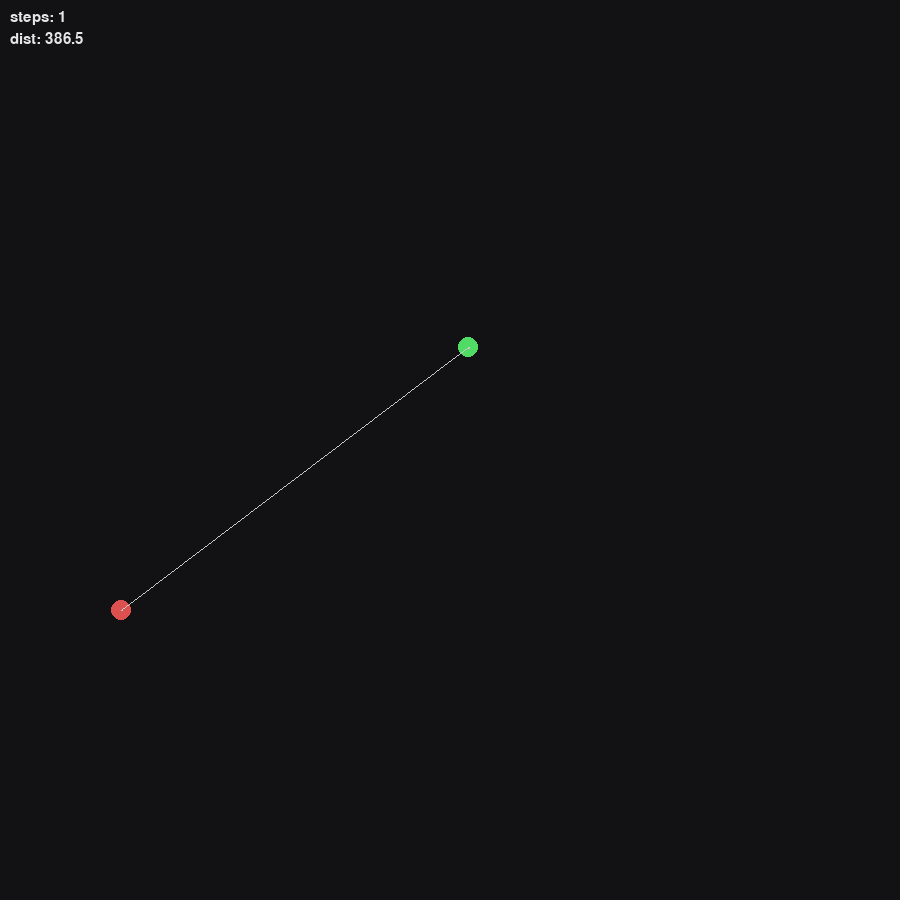

# Chaser-Runner

Adversarial reinforcement learning on a wrap-around 2D world: a **chaser** learns
pursuit and a **runner** learns evasion. Both control continuous acceleration.
TD3 is the default learner; the original sampled-action DQN remains available.

<p align="center">
  
</p>

## Quickstart

```bash
pip install torch                 # choose the CUDA build if appropriate
pip install -e ".[dev]"

# Start a preserved, uniquely named experiment.
chaser-runner train --run-name first --steps 50000

# Evaluate against the partner and fixed reference opponents, on held-out seeds.
chaser-runner eval --checkpoint runs/first --benchmark --episodes 100 --seed 20000

# Watch or record the latest policies.
chaser-runner play --checkpoint runs/first --fullscreen
chaser-runner record --checkpoint runs/first --out assets/first.gif
```

Training detects CUDA automatically; `--device cpu` forces CPU. Ctrl+C requests a
stop after the current complete training step, then saves a resumable checkpoint.
Weights are not checked into Git. The demo GIF shows trained TD3 policies.

## Continue training or start a new experiment

```bash
# The target is 100,000 decisions in total, including the first 50,000.
chaser-runner train --resume runs/first --steps 100000

# A separate run with different settings.
chaser-runner train --config configs/default.yaml --run-name another

# Watch independently selected best policies together.
chaser-runner play --chaser runs/first/policies/best_chaser.pt \
                   --runner runs/first/policies/best_runner.pt
```

`--steps` always means the **total target number of policy decisions**, including
resumed progress. Each decision holds an action for `env.action_repeat` physics
ticks (default 4). Episode lengths are reported in physics ticks. These step counts
are consequently different from older versions of this project.

A full resume restores the saved configuration and run directory. It accepts a
run directory or its latest `checkpoints/step_*.pt` file. Existing run names and
resuming older checkpoints over a newer run are rejected. Preserve the complete
run directory when moving or archiving an experiment. A process lock prevents two
training processes from writing the same run.

`--warm-start-chaser` and `--warm-start-runner` load policies into a **new** run with
fresh optimizer, replay, and exploration state. The old `--resume-chaser` and
`--resume-runner` flags are aliases for these weight-only warm starts; they do not
perform a full resume. Legacy `.pth` Q-network weights need an explicit matching
configuration, including `agent.algorithm: dqn`, the original hidden width, and
original physics/reward settings. New policy bundles contain their configuration.

## What is preserved?

```text
runs/first/
  config.json                  # effective configuration, including CLI overrides
  metadata.json                # initial Git revision, runtime and installed packages
  source.zip                   # actual package source and pyproject, including local edits
  sessions/<id>/               # config, runtime and source for each training invocation
  metrics.jsonl                # append-only metrics; session markers distinguish resumes
  status.json                  # running, interrupted, completed, or failed
  latest.json                  # pointer to the most recent complete training checkpoint
  checkpoints/step_*.pt        # both learners and the entire training state
  policies/initial.pt          # initial policies, including any warm-start inputs
  policies/latest.pt           # small, self-contained inference bundle for both roles
  policies/best_chaser.pt      # pair at the chaser's best validation step
  policies/best_runner.pt      # pair at the runner's best validation step
  evaluations/step_*.json      # repeatable validation benchmark results
  tensorboard/                 # optional live curves
```

Full checkpoints include online and target networks, optimizers, replay contents
and write positions, learner counters, exploration progress, opponent snapshots,
current opponent, in-flight episode, and Python/NumPy/PyTorch/CUDA RNG states.
Checkpoints use atomic replacement, and the latest pointer is published before
old checkpoints are pruned. The last `train.keep_checkpoints` full checkpoints are
kept (default 3). Best policy bundles are retained independently; they are
inference/warm-start artifacts, not full training checkpoints.

Resume is regression-tested to match uninterrupted training exactly on the same
CPU software stack. Changing device, package versions, or source may change the
trajectory; every invocation preserves its own runtime and source. Resume defaults
to the checkpoint's device; pass `--device cpu` explicitly to migrate a CUDA run.
An unexpected failure keeps the previous completed checkpoint. A hard process kill
can lose work since that checkpoint, and `status.json` can remain `running`.

```bash
tensorboard --logdir runs
```

`--no-log` disables TensorBoard while preserving metrics and all other artifacts.

## Learning and evaluation

TD3 uses a deterministic actor, twin Q critics, clipped target-action noise,
delayed actor updates, and softly updated target networks. The optional DQN uses
sampled continuous actions with Double DQN targets and Huber loss.

Only one role learns in each episode. Its opponent is held fixed for that episode
and sampled from a bounded historical policy pool (50% by default), a scripted
pursuit/evasion controller (30%), or a random policy (20%). The learner roles
alternate between episodes. This provides stable opponents within rollouts and
practice against reference strategies as the historical population evolves.

The six-dimensional state contains normalized shortest toroidal displacement,
chaser velocity, and runner velocity. Rewards are zero-sum: scaled distance
progress plus a capture bonus. Repeating actions gives acceleration time to affect
motion and extends the effective discount horizon. A capture is terminal; the
physics time limit cuts off a rollout and counts as runner survival in evaluation,
but the critic still bootstraps through this truncation. There is no timeout bonus.

Every `train.eval_interval` decisions, training runs a benchmark with exploration
disabled. Both environment resets and action sampling are seeded. Evaluation
preserves training RNG state and never adds data to replay. The matchups are:

- Current chaser versus current runner.
- Current chaser versus scripted and random runners.
- Scripted and random chasers versus the current runner.

Results include capture/survival rates, a Wilson 95% interval for capture rate,
mean episode length, mean distance, and both returns. Each role's best policies
are selected by mean win rate across its two fixed opponents; distance breaks
chaser ties, while survival duration and distance break runner ties. This is
validation selection. Use a different seed range for final evaluation and repeat
training with several seeds before claiming an improvement. A high paired capture
rate alone does not establish which role improved, and benchmark performance can
fluctuate during self-play.

```bash
# Inspect a particular selected pair on new episodes.
chaser-runner eval --checkpoint runs/first/policies/best_chaser.pt \
                  --benchmark --episodes 100 --seed 20000 --out evaluations/first.json

# Cross-play selected policies, or substitute a baseline.
chaser-runner eval --chaser runs/first/policies/best_chaser.pt \
                  --runner runs/first/policies/best_runner.pt --episodes 100
chaser-runner eval --checkpoint runs/first --runner scripted --episodes 100
```

Standalone evaluation always writes JSON. A policy bundle supplies architecture
and environment settings, and conflicting configurations are rejected. `scripted`,
`random`, and `stationary` can be used as either role's policy source.

## Configuration and development

[`configs/default.yaml`](configs/default.yaml) lists all settings. Partial YAML
files override defaults; unknown fields and invalid numeric settings fail early.
For the original learner, set `agent.algorithm: dqn`. Fields `sample_actions`,
`target_samples`, and `target_update_freq` apply only to DQN; `tau`, `policy_delay`,
`policy_noise`, and `noise_clip` apply to TD3. TD3 interprets the exploration
schedule as Gaussian action-noise standard deviation; DQN uses an epsilon-random
probability. Each learner first collects `agent.start_steps` random actions.

```bash
pytest
ruff check .
ruff format --check .
```

Tests cover physics, replay, actual TD3 learning on a known continuous objective,
evaluation isolation, exact training continuation for both algorithms, checkpoint
failure handling and retention, process locking, and CLI train/eval/GIF workflows.
See [training notes](docs/training.md) for the diagnosis and validation limits.

## Docker

```bash
docker build -t chaser-runner .
docker run --rm -v "$PWD/runs:/app/runs" chaser-runner train --run-name docker-first --steps 50000
docker run --rm -v "$PWD/runs:/app/runs" chaser-runner eval --checkpoint runs/docker-first --benchmark
```

The image starts with command help; it does not assume pretrained models exist.
Training, evaluation, and recording are headless. Use native `play` for a live window.
Rendering uses pygame-ce, which retains the `pygame` import API and supplies wheels
for newer Python versions.

## License

[MIT](LICENSE)
